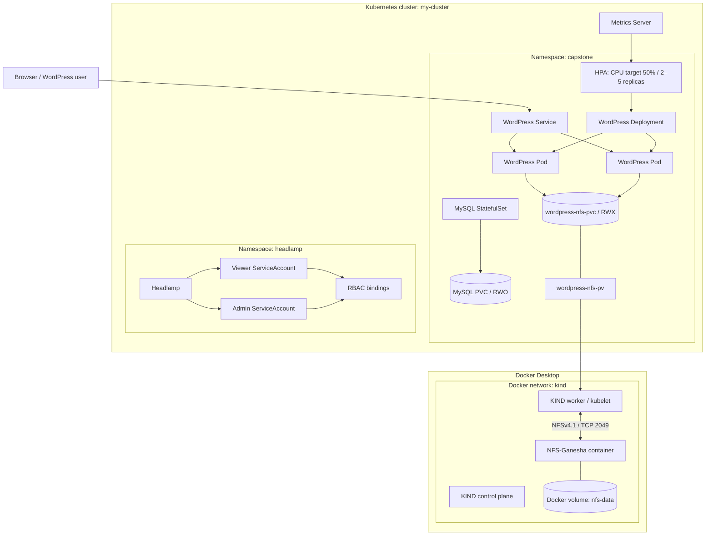

# Kubernetes WordPress + MySQL Capstone

[](https://kubernetes.io/)
[](https://kind.sigs.k8s.io/)
[](https://www.docker.com/)
[](https://helm.sh/)
[]()

A hands-on Kubernetes capstone that deploys **WordPress and MySQL on a local KIND cluster**, then extends the platform with persistent database storage, shared NFS-backed media uploads, resource metrics, automatic Pod scaling, and controlled dashboard access through Kubernetes RBAC.

This repository documents the implementation, validation, troubleshooting, and lessons learned while building the environment from the command line.

---

## Project highlights

| Area | What was implemented and verified |
|---|---|
| Application platform | WordPress Deployment and MySQL StatefulSet on KIND |
| Persistent database storage | Dedicated MySQL PersistentVolumeClaim |
| Shared media storage | NFS-Ganesha server with Kubernetes PV/PVC using ReadWriteMany |
| Cross-replica validation | A file written by one WordPress Pod was readable from the other Pod and NFS server |
| Real application validation | Uploaded WordPress media was visible through both replicas and on the NFS server |
| Metrics | Metrics Server v0.8.0 and Kubernetes Metrics API |
| Autoscaling | CPU-based HPA; tested scaling from 2 to 5 replicas and back to 2 |
| Kubernetes dashboard | Headlamp installed using Helm |
| Access control | Separate viewer and administrator ServiceAccounts with RBAC |
| Identity and permissions | Validated using `kubectl auth can-i` and `kubectl auth whoami` |

## Architecture

The local lab uses Docker Desktop and KIND. NFS-Ganesha runs as a separate Docker container on the KIND Docker network. The Kubernetes NFS PersistentVolume and PersistentVolumeClaim expose the export to the WordPress Pods.



### Key design decisions

- **Deployment for WordPress:** manages the stateless application replicas.
- **StatefulSet for MySQL:** provides stable workload identity and persistent storage association.
- **Separate storage paths:** MySQL data uses its own claim; only WordPress uploads are shared over NFS.
- **NFS-Ganesha in user space:** selected after the kernel NFS server could not be started successfully inside the KIND worker in this Docker Desktop environment.
- **Docker named volume for NFS export data:** the Windows bind-mounted filesystem appeared as 9P and did not support the VFS file-handle operation required by Ganesha; a Docker named volume provided the tested ext4 backing store.
- **HPA owns replica count:** the manually set `replicas` field was removed from the WordPress Deployment manifest so HPA could manage scaling.
- **Separate dashboard identities:** viewer permissions are read-only; administrator permissions use the built-in `cluster-admin` role for the lab.

## Technology stack

| Category | Tools / components |
|---|---|
| Container runtime | Docker Desktop, Docker Engine |
| Local Kubernetes | KIND, kubectl |
| Application | WordPress |
| Database | MySQL 8.4 |
| Storage | Kubernetes PV/PVC, NFSv4.1, NFS-Ganesha, Docker named volume |
| Metrics and scaling | Metrics Server 0.8.0, HPA (`autoscaling/v2`) |
| Kubernetes packaging | Helm |
| Dashboard | Headlamp |
| Authentication and authorization | ServiceAccounts, RBAC, short-lived tokens |
| Source control | Git, GitHub |

## Repository layout

```text
kubernetes-wordpress-mysql-capstone/
├── docs/
│   ├── local-nfs-server-docker-kind.md
│   ├── metrics-server-hpa.md
│   └── headlamp-kubernetes-rbac.md
├── helm-comparison/
├── manifests/
│   ├── WordPress and MySQL resources
│   ├── NFS PersistentVolume and PersistentVolumeClaim
│   ├── HPA
│   └── Headlamp ServiceAccounts and RBAC
├── metrics-server/
│   ├── components.yaml
│   └── components-kind.yaml
├── nfs-server/
│   ├── config/
│   ├── data/
│   └── logs/
├── kind-config.yml
├── day-60-capstone.md
└── README.md
```

> The `nfs-server/` directory is retained locally as a learning artifact. Runtime logs/data are excluded from Git as configured by `.gitignore`.

## Implementation and validation

### 1. Deploy WordPress and MySQL

The application stack runs in the `capstone` namespace. WordPress is managed by a Deployment and Service. MySQL runs as a StatefulSet with a dedicated persistent claim.

Useful checks:

```bash
kubectl get all -n capstone
kubectl get pods -n capstone -o wide
kubectl get pvc -n capstone
kubectl rollout status deployment/wordpress -n capstone
```

### 2. Configure shared NFS uploads

NFS-Ganesha exports `/exports` as the NFSv4 pseudo path `/wordpress-uploads`. The KIND worker reaches the NFS container on TCP port 2049. A manually configured Kubernetes PV/PVC makes the export available to both WordPress Pods at:

```text
/var/www/html/wp-content/uploads
```

Validation covered the whole data path:

1. A test file was created from the KIND worker and read from the NFS server.
2. A file was created in WordPress Pod 1 and read from Pod 2 and the NFS server.
3. An actual media upload through the WordPress Admin Dashboard was verified across both replicas and the NFS export.

### 3. Enable metrics and autoscaling

Metrics Server v0.8.0 exposes node and Pod resource metrics through the Metrics API. HPA monitors WordPress CPU utilization with these lab settings:

| HPA setting | Value |
|---|---:|
| CPU target | 50% |
| Minimum replicas | 2 |
| Maximum replicas | 5 |
| Scale-down stabilization window | 300 seconds |

The load test demonstrated:

```text
Scale out:  2 → 3 → 5 WordPress Pods
Scale in:   5 → 4 → 3 → 2 WordPress Pods
```

Useful checks:

```bash
kubectl get apiservice v1beta1.metrics.k8s.io
kubectl top nodes
kubectl top pods -n capstone
kubectl get hpa -n capstone
kubectl describe hpa wordpress-hpa -n capstone
```

### 4. Install Headlamp and configure RBAC

Headlamp was installed into the `headlamp` namespace using Helm. Automatic chart creation of a broad `cluster-admin` binding was disabled so custom access could be configured.

| Identity | Permissions in this lab |
|---|---|
| `headlamp-viewer` | Read-only `get`, `list`, `watch` for selected resources |
| `headlamp-admin` | Bound to built-in `cluster-admin` for administrative testing |

Permissions were checked using `kubectl auth can-i`. Token authentication was tested using an isolated temporary kubeconfig, and the authenticated identity was confirmed using `kubectl auth whoami`.

## Detailed documentation

The root README is the project overview. These guides contain implementation details, configuration examples, command walkthroughs, troubleshooting notes, and revision material.

| Guide | Contents |
|---|---|
| [Day 60 Capstone Notes](day-60-capstone.md) | Project overview, component inventory, practical achievements, repository map |
| [Local NFS Server for KIND](docs/local-nfs-server-docker-kind.md) | NFS-Ganesha setup, Docker networking and volume, export configuration, PV/PVC integration, UID/GID permissions, cross-Pod tests, troubleshooting |
| [Metrics Server and HPA](docs/metrics-server-hpa.md) | Metrics API, Metrics Server installation, CPU requests, HPA formula and behavior, scale testing, troubleshooting |
| [Headlamp and Kubernetes RBAC](docs/headlamp-kubernetes-rbac.md) | Helm installation, ServiceAccounts, ClusterRoles, bindings, token authentication, identity verification, permission tests |

## Run the lab

### Prerequisites

- Docker Desktop running with Linux containers.
- KIND installed.
- kubectl installed.
- Helm installed.
- Git Bash or another shell that supports the commands used in the lab.

### Create the KIND cluster

The cluster configuration is in [`kind-config.yml`](kind-config.yml). It defines one control-plane node and one worker using a pinned KIND node image.

```bash
kind create cluster --config kind-config.yml
kubectl cluster-info --context kind-my-cluster
kubectl get nodes -o wide
```

### Apply Kubernetes resources

Review the YAML in `manifests/` and apply resources in dependency order. The NFS server must be available on the KIND network before the NFS PV is mounted by WordPress. Keep credentials out of the repository; supply Secret values through your own local, secure process.

Example inspection/apply commands:

```bash
kubectl create namespace capstone
kubectl apply -f manifests/
kubectl get all -n capstone
kubectl get pv
kubectl get pvc -n capstone
```

> **Note:** These commands illustrate the workflow, not a guaranteed one-command bootstrap. Review the manifests and create dependencies (including Secrets and the NFS server) in the order described in the detailed NFS guide. Do not apply a directory blindly if it contains resources requiring prior configuration.

## Security notes

- The MySQL Secret manifest is excluded from Git.
- ServiceAccount tokens and kubeconfig credentials must never be committed.
- Viewer access follows least privilege and does not grant access to Secrets.
- The administrator ServiceAccount is bound to `cluster-admin` for this lab only; this is highly privileged and should not be used for routine access.
- The KIND Metrics Server manifest uses `--kubelet-insecure-tls` as a local lab workaround. It is not a production recommendation.
- NFS uses AUTH_SYS, Root Squash, and a lab Docker subnet allow-list. Production NFS needs a deliberately designed identity, network, access-control, and backup strategy.
- The NFS PV advertises 1Gi as Kubernetes capacity metadata; that value is not an enforced quota on the underlying Docker volume.
- The NFS container is a single point of failure. This is a learning lab, not an HA production storage service.

## Cleanup and resource preservation

The lab runtime was cleaned up after validation:

- KIND cluster `my-cluster` deleted.
- NFS-Ganesha container removed.
- Docker volume `nfs-data` removed (this deleted its runtime export contents).
- Local repository and the complete local `nfs-server/` directory preserved.
- `kindest/node` and `mysql:8.4` images intentionally retained for future practice.
- Docker build cache was already 0B.
- OpenClaw resources were explicitly left untouched.

To delete a future KIND lab cluster:

```bash
kind delete cluster --name my-cluster
```

Do not run broad Docker volume/network prune commands on a shared development machine without checking what they contain. This environment also contains unrelated OpenClaw resources.

## Project status

**Day 60 capstone: completed and tested.** The repository retains the implementation manifests and detailed notes; the local runtime cluster and NFS runtime volume were removed after verification.

## What this project demonstrates

- Deploying and operating application and database workloads on Kubernetes.
- Designing separate persistent storage for database data and shared uploads.
- Debugging NFS connectivity, filesystem behavior, root squashing, and permissions.
- Observing resource metrics and proving HPA scale-out/scale-in with a load test.
- Installing a Kubernetes dashboard with Helm.
- Applying RBAC least-privilege concepts and validating authorization.
- Handling credentials and cleaning up infrastructure without removing unrelated resources.

---

**Part of a hands-on 90-Day DevOps learning journey — Day 60.**
