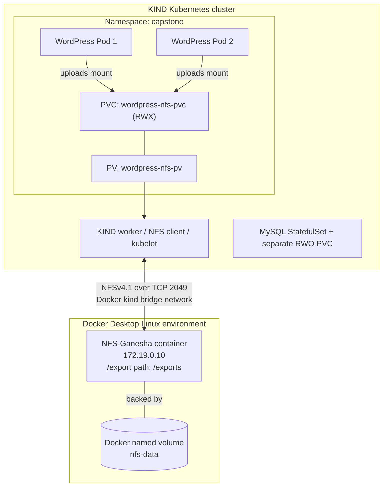

# Local NFS Server for Kubernetes KIND Using Docker and NFS-Ganesha

> **Project:** Kubernetes WordPress + MySQL Capstone\
> **Purpose:** Local shared ReadWriteMany (RWX) storage for WordPress
> uploads without relying on a paid cloud NFS service.\
> **Result:** NFS-Ganesha, Kubernetes PV/PVC integration, Pod-to-Pod
> file sharing, and actual WordPress media uploads were successfully
> verified.

## 1. Tested environment

  --------------------------------------------------------------------------------
  Component                           Observed value
  ----------------------------------- --------------------------------------------
  Host                                Windows 11

  Terminal                            Git Bash (MSYS) in VS Code

  Docker Desktop                      4.99.0

  Docker Engine                       29.9.3

  Docker context                      `desktop-linux`

  Container OS/architecture           Linux / x86_64 (amd64)

  Kubernetes                          KIND, server v1.37.0

  kubectl client                      v1.36.1

  KIND context                        `kind-my-cluster`

  NFS image                           `ghcr.io/kubernetes-sigs/nfs-ganesha:v6.5`

  NFS-Ganesha                         V6.5

  Docker network                      `kind`, subnet `172.19.0.0/16`, gateway
                                      `172.19.0.1`

  KIND control-plane                  `172.19.0.2`

  KIND worker                         `172.19.0.3`

  NFS container                       `172.19.0.10`

  Namespace                           `capstone`

  NFS protocol                        NFSv4.1 over TCP
  --------------------------------------------------------------------------------

Addresses and versions are specific to this tested environment.

## 2. Objective and architecture

WordPress stores uploaded media under
`/var/www/html/wp-content/uploads`. If multiple replicas use only their
individual container writable layers, uploads are not reliably shared
between replicas and may be lost when a Pod is replaced.

This lab runs NFS-Ganesha in a Docker container. Its `/exports`
directory is backed by Docker named volume `nfs-data`. The KIND worker
accesses the NFS export, and a Kubernetes PersistentVolume (PV) and
PersistentVolumeClaim (PVC) expose it to both WordPress Pods.

Only the uploads directory is shared. WordPress application files,
themes, and plugins are not shared by this mount. MySQL remains on its
own StatefulSet PVC.

### Architecture diagram



**Data path:** WordPress writes into its mounted uploads directory → NFS
client → NFS-Ganesha export → `/exports` → Docker named volume
`nfs-data`.

**Network path:** KIND worker `172.19.0.3` communicates with NFS-Ganesha
`172.19.0.10` over the Docker `kind` bridge network, using NFSv4.1/TCP
port 2049.

The Docker named volume is managed inside Docker Desktop's Linux
environment. It is separate from the Windows bind mounts used for
configuration and logs.

## 3. Why a separate NFS-Ganesha container?

KIND nodes are containers, not independent VMs with separate Linux
kernels. In this Docker Desktop + WSL2 environment, the KIND node
containers use the Linux kernel provided by the Docker Desktop/WSL2
environment.

An initial attempt loaded the kernel `nfsd` module inside the KIND
worker and mounted `/proc/fs/nfsd`. However, the server thread count
remained zero and the port list was empty; the kernel NFS server was not
started. That attempt was cleaned up. NFS-Ganesha, a user-space NFS
server, was selected instead.

Cleanup commands used after the initial investigation:

``` bash
docker exec my-cluster-worker umount /proc/fs/nfsd
docker exec my-cluster-worker modprobe -r nfsd
docker exec my-cluster-worker modprobe -r nfs
docker exec my-cluster-worker modprobe -r grace
```

The NFS client module was loaded again later for the successful client
mount. `sunrpc` remaining loaded was not evidence that an NFS server was
running.

## 4. Repository layout

``` text
kubernetes-wordpress-mysql-capstone/
├── docs/
│   └── local-nfs-server-docker-kind.md
├── manifests/
│   ├── nfs-pv.yml
│   ├── nfs-pvc.yml
│   ├── wordpress-deployment.yml
│   └── ...
└── nfs-server/
    ├── config/
    │   └── ganesha.conf
    ├── data/
    │   └── nfs-test.txt
    └── logs/
        └── ganesha.log
```

Create directories:

``` bash
mkdir -p docs
mkdir -p nfs-server/config
mkdir -p nfs-server/data
mkdir -p nfs-server/logs
```

`nfs-server/data` was used for an initial Windows bind-mount test and
retains a troubleshooting artifact. The final NFS data is stored in
Docker named volume `nfs-data`, not in this host directory.

## 5. Inspect the NFS-Ganesha image

Image:

``` text
ghcr.io/kubernetes-sigs/nfs-ganesha:v6.5
```

Pull and inspect:

``` bash
docker pull ghcr.io/kubernetes-sigs/nfs-ganesha:v6.5

docker image inspect ghcr.io/kubernetes-sigs/nfs-ganesha:v6.5 \
  --format 'Architecture: {{.Architecture}} | OS: {{.Os}} | Entrypoint: {{json .Config.Entrypoint}} | Cmd: {{json .Config.Cmd}}'

docker run --rm --entrypoint /usr/local/bin/ganesha.nfsd \
  ghcr.io/kubernetes-sigs/nfs-ganesha:v6.5 -v

docker run --rm --entrypoint /usr/local/bin/ganesha.nfsd \
  ghcr.io/kubernetes-sigs/nfs-ganesha:v6.5 -h
```

Observed facts:

-   Linux/amd64 image; Ganesha version `V6.5`.
-   Executable: `/usr/local/bin/ganesha.nfsd`.
-   No automatic Ganesha entrypoint; image command was `/bin/bash`.
-   Example configuration was found at
    `/usr/local/etc/ganesha/ganesha.conf`.
-   VFS backend library `libfsalvfs.so` was present.
-   Image metadata exposed 2049/tcp, 111/tcp, 111/udp and 20048/tcp.
    This lab uses NFSv4.1 over TCP 2049.
-   `--help` returned an invalid-option response; `-h` displayed usage.

## 6. Docker network

Inspect the KIND network:

``` bash
docker network inspect kind
docker network inspect kind \
  --format '{{.Name}} {{range .IPAM.Config}}{{.Subnet}} gateway={{.Gateway}}{{end}}'
```

Observed:

``` text
kind 172.19.0.0/16 gateway=172.19.0.1
```

Observed node addresses:

``` text
my-cluster-control-plane  172.19.0.2
my-cluster-worker         172.19.0.3
```

The NFS container was assigned `172.19.0.10` after checking that the
address was available. Check your own network before reusing this
address.

## 7. Docker named volume

Create and inspect the volume:

``` bash
docker volume create nfs-data
docker volume inspect nfs-data
```

The observed volume used the `local` driver and had a mountpoint inside
Docker's Linux environment:

``` text
/var/lib/docker/volumes/nfs-data/_data
```

Test the volume:

``` bash
docker run --rm \
  -v nfs-data:/exports \
  --entrypoint sh \
  ghcr.io/kubernetes-sigs/nfs-ganesha:v6.5 \
  -c 'df -T /exports && touch /exports/volume-test.txt && ls -l /exports'
```

The filesystem was observed as `ext4`; the write succeeded.
`volume-test.txt` remained in the volume.

### Why not export a Windows bind mount?

The initial Windows bind-mounted directory appeared inside the Linux
container as a 9P filesystem. Ganesha's VFS FSAL could not obtain the
required file handle:

``` text
Could not get handle for path /exports, error Operation not supported
FSAL_ERROR=(Operation not supported,95)
release_posix_file_system ... type=9p
```

Switching the export data to Docker named volume `nfs-data` provided an
ext4 filesystem and resolved this VFS export-root problem. The Windows
bind mounts remain suitable for configuration and logs.

## 8. NFS-Ganesha configuration

File: `nfs-server/config/ganesha.conf`

``` conf
NFS_CORE_PARAM {
    Protocols = 4;
    allow_set_io_flusher_fail = true;
    Enable_UDP = false;
    Enable_RQUOTA = false;
}
EXPORT {
    Export_Id = 1;
    Path = /exports;
    Pseudo = /wordpress-uploads;
    Access_Type = RW;
    Squash = Root_Squash;
    SecType = sys;

    CLIENT {
        Clients = 172.19.0.0/16;
    }

    FSAL {
        Name = VFS;
    }
}
LOG {
    COMPONENTS {
        FSAL = FULL_DEBUG;
        EXPORT = FULL_DEBUG;
        NFS4 = FULL_DEBUG;
    }

    Default_Log_Level = INFO;

    Facility {
        name = FILE;
        destination = "/var/log/ganesha/ganesha.log";
        enable = active;
    }
}
```

Validate the configuration:

``` bash
docker run --rm --entrypoint /usr/local/bin/ganesha.nfsd \
  -v "$(pwd)/nfs-server/config:/etc/ganesha:ro" \
  ghcr.io/kubernetes-sigs/nfs-ganesha:v6.5 \
  -T -f /etc/ganesha/ganesha.conf
```

The parser test exited with code `0`.

### Configuration meaning

  ------------------------------------------------------------------------
  Setting                              Meaning
  ------------------------------------ -----------------------------------
  `Protocols = 4`                      NFSv4 protocol family

  `allow_set_io_flusher_fail = true`   Continue if the container cannot
                                       set the optional I/O flusher
                                       process setting

  `Enable_UDP = false`                 Disable UDP; this lab uses TCP

  `Enable_RQUOTA = false`              Disable remote quota service, not
                                       required here

  `Export_Id = 1`                      Unique export ID

  `Path = /exports`                    Actual directory inside the server
                                       container

  `Pseudo = /wordpress-uploads`        NFSv4 pseudo path presented to the
                                       client

  `Access_Type = RW`                   Read/write export

  `Squash = Root_Squash`               Map remote root to an anonymous
                                       identity

  `SecType = sys`                      AUTH_SYS identity-based
                                       authentication, not Kerberos

  `Clients = 172.19.0.0/16`            Allow clients from the KIND Docker
                                       subnet

  `FSAL Name = VFS`                    Use the VFS filesystem abstraction
                                       layer
  ------------------------------------------------------------------------

Logs are written to `/var/log/ganesha/ganesha.log`, bind-mounted to
`nfs-server/logs/`. FSAL, EXPORT, and NFS4 components use `FULL_DEBUG`;
this is useful for troubleshooting but verbose.

## 9. Start the NFS-Ganesha container

The container needs a runtime directory for its PID file. The image
expected:

``` text
/usr/local/var/run/ganesha/ganesha.pid
```

Without the directory, startup failed with:

``` text
FATAL : open(/usr/local/var/run/ganesha/ganesha.pid, O_CREAT | O_RDWR, 0644) failed
No such file or directory (2)
```

The final command creates the directory before launching Ganesha.

Remove a previous container with the same name, if present:

``` bash
docker rm -f nfs-server 2>/dev/null || true
```

Start the server:

``` bash
docker run -d \
  --name nfs-server \
  --network kind \
  --ip 172.19.0.10 \
  --restart unless-stopped \
  --cap-add DAC_READ_SEARCH \
  -v nfs-data:/exports \
  -v "$(pwd)/nfs-server/config:/etc/ganesha:ro" \
  -v "$(pwd)/nfs-server/logs:/var/log/ganesha" \
  --entrypoint /bin/bash \
  ghcr.io/kubernetes-sigs/nfs-ganesha:v6.5 \
  -c 'mkdir -p /usr/local/var/run/ganesha && exec /usr/local/bin/ganesha.nfsd -F -L /dev/stderr -f /etc/ganesha/ganesha.conf'
```

Verify:

``` bash
docker ps --filter name=nfs-server

docker inspect nfs-server \
  --format '{{range .NetworkSettings.Networks}}{{.IPAddress}}{{end}}'

docker logs nfs-server
tail -n 100 nfs-server/logs/ganesha.log
```

The expected address in this lab is `172.19.0.10`. Logs showed the
default pseudo-root export and the configured export ID 1 with pseudo
path `/wordpress-uploads` and path `/exports`. The server initialized
and stayed running.

Check the TCP 2049 listener:

``` bash
docker exec nfs-server sh -c 'grep -i ":0801" /proc/net/tcp /proc/net/tcp6'
```

`0801` is hexadecimal for TCP port 2049. A listening socket was
observed.

### Why `CAP_DAC_READ_SEARCH`?

The first client mount attempt failed with `Operation not permitted`.
Investigation found the server container lacked `CAP_DAC_READ_SEARCH`,
needed by the VFS FSAL file-handle operations in this setup. Recreating
the server with:

``` bash
--cap-add DAC_READ_SEARCH
```

resolved the problem. The capability was verified with `capsh --print`;
`--privileged` was not needed.

## 10. KIND worker NFS client and manual mount test

The worker had `/usr/sbin/mount.nfs`; util-linux 2.41.5 was observed.

Load the client module and create a mount point:

``` bash
docker exec my-cluster-worker modprobe nfs
docker exec my-cluster-worker mkdir -p /mnt/nfs-uploads-test
```

Mount the export:

``` bash
docker exec my-cluster-worker mount -v \
  -t nfs4 \
  -o vers=4.1,proto=tcp \
  172.19.0.10:/wordpress-uploads \
  /mnt/nfs-uploads-test
```

Verify:

``` bash
docker exec my-cluster-worker findmnt /mnt/nfs-uploads-test
```

Observed source and options included:

``` text
172.19.0.10:/wordpress-uploads
nfs4
rw
vers=4.1
proto=tcp
addr=172.19.0.10
```

A temporary pseudo-root mount (`172.19.0.10:/`) at `/mnt/nfs-root` was
also used for diagnosis. The direct export mount is the relevant one for
the PV.

These manual mounts are diagnostic mounts. Kubernetes/kubelet also
manages the mount used by the Pod. Do not unmount a filesystem while a
Pod is actively using the PVC.

## 11. Root Squash and filesystem permissions

Initially `/exports` was `root:root`, mode `755`. With `Root_Squash`,
root from the NFS client was mapped to anonymous UID/GID
`4294967294:4294967294`. The client could list the export but could not
create files in the root-owned directory.

A diagnostic ownership change allowed the root-squashed worker identity
to write:

``` bash
docker exec nfs-server chown 4294967294:4294967294 /exports
```

Then the WordPress process identity was checked:

``` bash
kubectl exec -n capstone wordpress-5d9976649f-b6b4n -- id www-data
```

Observed:

``` text
uid=33(www-data) gid=33(www-data) groups=33(www-data)
```

The anonymous UID and WordPress UID 33 are different. A `755` directory
owned by the anonymous identity would not allow `www-data` to write. The
final lab ownership was changed to UID/GID 33:

``` bash
docker exec nfs-server chown 33:33 /exports
docker exec nfs-server chmod 755 /exports
docker exec nfs-server stat -c 'UID=%u GID=%g MODE=%a PERMISSIONS=%A' /exports
```

Observed:

``` text
UID=33 GID=33 MODE=755 PERMISSIONS=drwxr-xr-x
```

`Root_Squash` remained enabled. WordPress could then create uploaded
files.

**Security note:** This ownership and AUTH_SYS configuration is a lab
arrangement, not a complete production NFS security design. Production
requires deliberate identity mapping, network restrictions, access
controls, backups, and an appropriate security model.

## 12. Kubernetes PersistentVolume

Actual file: `manifests/nfs-pv.yml`

``` yaml
apiVersion: v1
kind: PersistentVolume
metadata:
  name: wordpress-nfs-pv
spec:
  capacity:
    storage: 1Gi
  accessModes:
    - ReadWriteMany
  persistentVolumeReclaimPolicy: Retain
  storageClassName: nfs-manual
  mountOptions:
    - proto=tcp
    - nfsvers=4.1
  nfs:
    server: 172.19.0.10
    path: /wordpress-uploads
```

Apply and inspect:

``` bash
kubectl apply -f manifests/nfs-pv.yml
kubectl get pv wordpress-nfs-pv
kubectl describe pv wordpress-nfs-pv
```

Key fields:

-   `ReadWriteMany`: multiple Pods/nodes can mount read-write, subject
    to server support and permissions.
-   `Retain`: released storage is not automatically reclaimed; manual PV
    reclamation is required.
-   `nfs-manual`: manually provisioned StorageClass name, not a dynamic
    NFS provisioner.
-   `server`: NFS server address reachable from KIND worker.
-   `path`: NFSv4 pseudo path.
-   `mountOptions`: NFSv4.1 over TCP.

The PV advertises `1Gi`. This is Kubernetes capacity metadata; it is not
a hard quota on the NFS export. The Docker volume's observed filesystem
capacity was approximately 1007G.

## 13. Kubernetes PersistentVolumeClaim

Actual file: `manifests/nfs-pvc.yml`

``` yaml
apiVersion: v1
kind: PersistentVolumeClaim
metadata:
  name: wordpress-nfs-pvc
  namespace: capstone
spec:
  accessModes:
    - ReadWriteMany
  storageClassName: nfs-manual
  resources:
    requests:
      storage: 1Gi
  volumeName: wordpress-nfs-pv
```

Apply and inspect:

``` bash
kubectl apply -f manifests/nfs-pvc.yml
kubectl get pvc -n capstone
kubectl describe pvc wordpress-nfs-pvc -n capstone
```

`volumeName` explicitly binds the claim to `wordpress-nfs-pv`.

Observed storage resources:

``` text
NAME                                       CAPACITY   ACCESS MODES   RECLAIM POLICY   STATUS   CLAIM
pvc-db9a923d-5e07-4deb-9f4b-fbe931fa6921   1Gi        RWO            Delete           Bound    capstone/mysql-storage-mysql-0
wordpress-nfs-pv                           1Gi        RWX            Retain           Bound    capstone/wordpress-nfs-pvc
```

PVCs:

``` text
NAME                    STATUS   VOLUME
mysql-storage-mysql-0   Bound    pvc-db9a923d-5e07-4deb-9f4b-fbe931fa6921
wordpress-nfs-pvc       Bound    wordpress-nfs-pv
```

MySQL storage is separate and must not be confused with the WordPress
NFS claim.

## 14. WordPress Deployment integration

The actual Deployment mounts the PVC only at the uploads path:

``` yaml
          volumeMounts:
            - name: wordpress-uploads
              mountPath: /var/www/html/wp-content/uploads
      volumes:
        - name: wordpress-uploads
          persistentVolumeClaim:
            claimName: wordpress-nfs-pvc
```

The volume name in `volumeMounts` must match the name under Pod
`volumes`; `claimName` must match the PVC in `capstone`.

Apply and verify:

``` bash
kubectl apply -f manifests/wordpress-deployment.yml
kubectl rollout status deployment/wordpress -n capstone
kubectl get pods -n capstone -o wide
```

Inspect the mount:

``` bash
kubectl describe pod -n capstone <wordpress-pod-name>
kubectl exec -n capstone <wordpress-pod-name> -- \
  df -h /var/www/html/wp-content/uploads
```

The Pod description showed:

``` text
/var/www/html/wp-content/uploads from wordpress-uploads (rw)
```

Observed filesystem output:

``` text
Filesystem                      Size  Used Avail Use% Mounted on
172.19.0.10:/wordpress-uploads 1007G  8.0G  948G   1% /var/www/html/wp-content/uploads
```

This was a point-in-time measurement, not a fixed capacity guarantee.

## 15. Verification results

### 15.1 Worker-to-server write/read

A file was created from the KIND worker through the NFS mount:

``` bash
docker exec my-cluster-worker sh -c \
  'echo "Created from KIND worker through NFS" > /mnt/nfs-uploads-test/kind-nfs-test.txt'

docker exec nfs-server cat /exports/kind-nfs-test.txt
```

The server returned:

``` text
Created from KIND worker through NFS
```

### 15.2 Pod 1 → Pod 2 → NFS server

A file was written as the WordPress web user in Pod 1:

``` bash
kubectl exec -n capstone wordpress-5d9976649f-b6b4n -- \
  su -s /bin/sh www-data -c \
  'echo "NFS shared storage test from WordPress Pod 1" > /var/www/html/wp-content/uploads/nfs-pod1-test.txt'
```

It was read from Pod 1, Pod 2, and the NFS server:

``` bash
kubectl exec -n capstone wordpress-5d9976649f-b6b4n -- \
  cat /var/www/html/wp-content/uploads/nfs-pod1-test.txt

kubectl exec -n capstone wordpress-5d9976649f-kpmqk -- \
  cat /var/www/html/wp-content/uploads/nfs-pod1-test.txt

docker exec nfs-server cat /exports/nfs-pod1-test.txt
```

All returned:

``` text
NFS shared storage test from WordPress Pod 1
```

This verified that the two Pods and server see the same exported file.

### 15.3 Actual WordPress media upload

An image was uploaded through the WordPress Admin Dashboard. WordPress
stored the original and resized variants under its year/month directory:

``` text
2026/11/
```

The following commands were run:

``` bash
kubectl exec -n capstone wordpress-5d9976649f-kpmqk -- \
  find /var/www/html/wp-content/uploads -maxdepth 4 -type f -print

kubectl exec -n capstone wordpress-5d9976649f-b6b4n -- \
  find /var/www/html/wp-content/uploads -maxdepth 4 -type f -print

docker exec nfs-server \
  find /exports -maxdepth 4 -type f -print
```

Uploaded files appeared in both Pods and the NFS server. Examples:

``` text
172-private-ec2-configuration2.png
172-private-ec2-configuration2-150x147.png
172-private-ec2-configuration2-300x55.png
172-private-ec2-configuration2-768x141.png
AWS-VPC-Network-Load-Balancer-Architecture.png
AWS-VPC-Network-Load-Balancer-Architecture-1024x512.png
AWS-VPC-Network-Load-Balancer-Architecture-300x150.png
AWS-VPC-Network-Load-Balancer-Architecture-768x384.png
AWS-VPC-Network-Load-Balancer-Architecture-1536x768.png
```

WordPress generates different resized variants depending on image
dimensions and configured image sizes.

**Result:** The actual WordPress media-upload workflow was verified
across both replicas and the NFS server.

### Why the first top-level `ls` did not show the image

WordPress stores media under year/month directories such as
`uploads/2026/11/`. A non-recursive `ls` of `uploads/` only shows the
`2026` directory. Use `find` to inspect nested files.

## 16. Troubleshooting summary

  -------------------------------------------------------------------------------------------------
  Problem                      Cause                          Tested resolution
  ---------------------------- ------------------------------ -------------------------------------
  Kernel `nfsd` did not start  `nfsd` thread count remained   Clean up kernel-server attempt; use
  in KIND worker               zero; no server ports          separate NFS-Ganesha container

  Ganesha PID file open failed `/usr/local/var/run/ganesha`   `mkdir -p` before starting Ganesha
                               absent                         

  `PR_SET_IO_FLUSHER` EPERM    Container lacked optional      `allow_set_io_flusher_fail = true;`
                               process-setting privilege      

  VFS FSAL                     Windows bind mount unsuitable  Use Docker named volume (observed
  `Operation not supported`,   for this VFS handle operation  ext4) for `/exports`
  filesystem type 9P                                          

  UDP/RQUOTA registration      Unneeded registrations in      Disable UDP and RQUOTA
  errors                       TCP-only NFSv4 lab             

  Client mount                 Server container lacked        Add `--cap-add DAC_READ_SEARCH`
  `Operation not permitted`    `CAP_DAC_READ_SEARCH`          

  Root-squashed client could   Export root owned by root,     Diagnostic ownership to anonymous
  list but not write           mode 755                       UID/GID

  WordPress `www-data` could   WordPress UID 33 differs from  Final export root ownership `33:33`,
  not write                    anonymous UID                  mode `755`

  Uploaded image not in        WordPress stores media in      Use `find` with depth
  top-level listing            year/month folders             
  -------------------------------------------------------------------------------------------------

Useful exact troubleshooting commands:

``` bash
# Ganesha logs
docker logs nfs-server
tail -n 100 nfs-server/logs/ganesha.log

# Server capabilities
docker exec nfs-server capsh --print

# Export directory ownership
docker exec nfs-server stat -c 'UID=%u GID=%g MODE=%a PERMISSIONS=%A' /exports

# Pod process identity
kubectl exec -n capstone <wordpress-pod-name> -- id www-data

# Recursive upload listing
kubectl exec -n capstone <wordpress-pod-name> -- \
  find /var/www/html/wp-content/uploads -maxdepth 4 -type f -print
```

## 17. Operational checks

``` bash
# NFS container
docker ps --filter name=nfs-server
docker logs --tail 100 nfs-server

# Kubernetes storage
kubectl get pv
kubectl get pvc -n capstone
kubectl describe pv wordpress-nfs-pv
kubectl describe pvc wordpress-nfs-pvc -n capstone

# WordPress Pods
kubectl get pods -n capstone -o wide

# Pod mount and filesystem
kubectl describe pod -n capstone <wordpress-pod-name>
kubectl exec -n capstone <wordpress-pod-name> -- \
  df -h /var/www/html/wp-content/uploads
```

## 18. Cleanup and data preservation

**Do not run cleanup while WordPress Pods are using the NFS PVC.** The
following operations are separate; choose only what is intended.

### 18.1 Safe sequence before removing the server

1.  Stop or update workloads that mount `wordpress-nfs-pvc`.
2.  Verify no Pod is using the claim.
3.  Only then unmount diagnostic mounts and stop/remove the NFS
    container if desired.

Do not delete the PVC or PV as a casual troubleshooting step.

### 18.2 Remove manual diagnostic mounts

Only after they are no longer in use:

``` bash
docker exec my-cluster-worker umount /mnt/nfs-uploads-test
docker exec my-cluster-worker umount /mnt/nfs-root
```

Check current mounts first:

``` bash
docker exec my-cluster-worker findmnt
```

### 18.3 Stop or remove the NFS container

``` bash
docker stop nfs-server
docker rm nfs-server
```

Removing the container does not remove Docker named volume `nfs-data`.

### 18.4 Preserve or deliberately delete the volume

The NFS data is in Docker volume:

``` text
nfs-data
```

Do not remove it if WordPress media must be retained.

Only if permanent deletion is intended and the data is backed up or no
longer needed:

``` bash
docker volume rm nfs-data
```

This is destructive and deletes the data stored in that volume.

### 18.5 PV reclaim policy

The NFS PV uses `persistentVolumeReclaimPolicy: Retain`. Releasing the
PVC does not automatically delete the NFS files. The PV may become
Released and need manual reclamation/rebinding. `Retain` is not a
backup.

**Cleanup status:** The working NFS container, Docker volume, PV and PVC
were retained after verification. The destructive cleanup sequence above
is documented guidance and was not executed.

## 19. Limitations and production alternatives

This is a local learning setup, not a highly available production
storage service.

-   One NFS container is a single point of failure.
-   The Docker named volume is local to the Docker Desktop environment.
-   AUTH_SYS and the broad `172.19.0.0/16` client allowance are lab
    choices, not a complete production security posture.
-   The PV's advertised `1Gi` is not an enforced quota on the Docker
    volume.
-   Only uploads are shared; themes and plugins are not shared by this
    mount.
-   The current WordPress Deployment uses `wordpress:latest`; production
    should pin a tested image version or digest.
-   A Docker volume is not a backup; back up important data separately.

Production alternatives include Amazon EFS for managed shared NFS
storage on AWS, object storage such as Amazon S3 with a suitable
WordPress integration for media, and immutable application images/CI/CD
for distributing themes and plugins consistently.

## 20. Key concepts learned

1.  NFS provides network-accessible filesystem storage.
2.  NFS-Ganesha is a user-space NFS server.
3.  This lab uses NFSv4.1 over TCP.
4.  Docker named volumes persist independently of a container's writable
    layer.
5.  Kubernetes PV represents provisioned storage; PVC requests storage
    for workloads.
6.  RWX permits multiple Pods/nodes to mount read-write when supported
    by the backend.
7.  Root Squash maps remote root to an anonymous identity.
8.  NFS filesystem permissions still apply; WordPress ran as UID/GID 33.
9.  Shared uploads do not make WordPress application files or MySQL
    highly available.

## 21. Final verification checklist

-   [x] NFS-Ganesha V6.5 started in Docker.
-   [x] NFS export initialized and listened on TCP 2049.
-   [x] KIND worker mounted the export using NFSv4.1 over TCP.
-   [x] Kubernetes NFS PV and PVC reached `Bound`.
-   [x] Both WordPress Pods mounted the shared uploads directory.
-   [x] File written from Pod 1 was readable from Pod 2 and NFS server.
-   [x] Actual WordPress media upload appeared in both Pods and NFS
    server.

**Final result:** Local Docker + NFS-Ganesha + KIND shared storage was
successfully implemented and verified for WordPress uploads.
